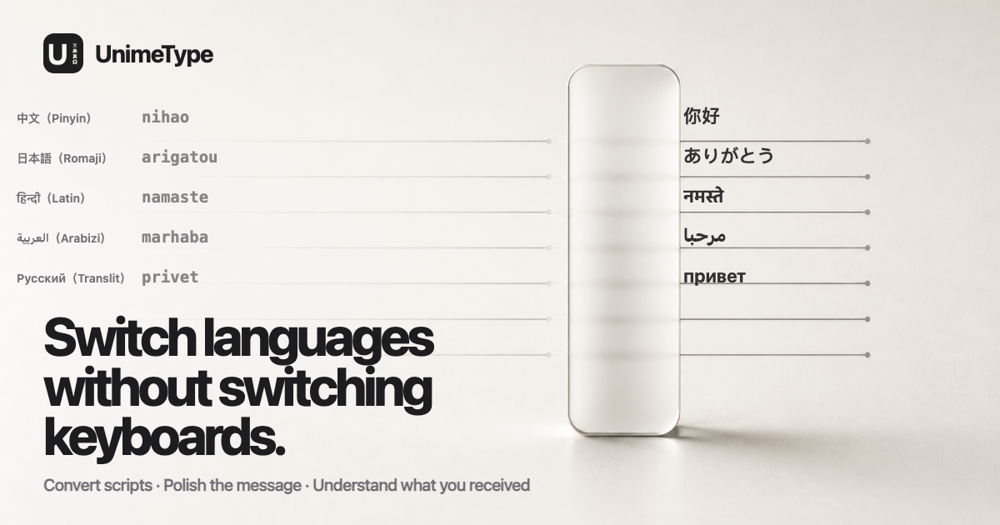

  

<h1 align="center">UnimeType</h1>

  <strong>一个键盘输入多种语言——跨应用切窗口与句内双语混打，再也不用切换键盘。</strong> 
  UnimeType 官方社区门户、包管理器安装指南与公开问题反馈仓库（覆盖 macOS、Windows、Linux、iOS、Android 与 ChromeOS）。

  <a href="./README.md">English</a> ·
  <a href="https://unimetype.com/zh/download">前往下载</a> ·
  <a href="https://unimetype.com/zh/docs">使用文档</a> ·
  <a href="https://github.com/UnimeType/transliteration">端侧推理工具箱</a> ·
  <a href="https://huggingface.co/UnimeType">Hugging Face 模型权重</a> ·
  <a href="https://github.com/UnimeType/unimetype/issues">提交反馈</a>

---

## 为什么做 UnimeType

日常用「一门母语 + 英语」工作和聊天时，传统输入法逼着你在每次切窗口、每敲一句双语消息时反复猜当前处于中文还是英文状态：

- **设计软件（`Figma` / `Photoshop` / `Blender`）** — 刚回完一条消息切回画布，按 `V`、`R`、`T` 单键快捷键，屏幕上却弹出一排拼音候选框。
- **科研写作（`Overleaf` / `LaTeX` / `Markdown`）** — 想敲一行 `\cite{}` 或半角数学符号，结果输入法直接吐出全角括号和重音候选字。
- **外贸与跨软件沟通** — 一边在 `WhatsApp`、`Mail`、`Excel` 里写英文报价单，一边切回微信或 `Slack` 跟工厂和同事对进度，每次落指前都得先低头或抬头确认输入状态。
- **游戏操作（`WASD` / `Shift`）** — 按下 `Shift` 加速跑，输入法候选条突然抢走焦点把人物卡在原地。
- **开发终端（`VS Code` / `Terminal` / `Vim`）** — 系统自作聪明记住每个窗口上次的输入源，切回编辑器按 `Esc` 照样被中文状态拦住。

UnimeType 把「打字」和「转换」彻底拆开：键盘全程留在干净的英文 ASCII 状态，快捷键与英文单词直接落屏；需要母语时一口气敲完拼音（或罗马音等拉丁转写），按一次 **Caps Lock**（手机端点一下 **转换**），整句原地变成母语，句中的英文专业词、`@用户名`、网址、文件路径和代码片段原封不动保留。

---

## 下载与包管理器安装

请始终从 **[unimetype.com/zh/download](https://unimetype.com/zh/download)** 或下方官方包管理器获取签名安装包：

| 平台 | 官方下载 / 应用商店 | 命令行包管理器 / 渠道 |
| --- | --- | --- |
| **macOS**（`14.0+`，Apple Silicon & Intel） | [下载通用 `.dmg`](https://unimetype.com/zh/download#macos) | `brew install --cask losdwind/tap/unimetype` |
| **Windows**（`10 / 11`，`x64` & `ARM64`） | [下载签名安装包 `.exe`](https://unimetype.com/zh/download#windows) | `winget install UnimeType.UnimeType` |
| **Linux**（`X11` & `Wayland`） | [下载 `.deb` / `.rpm`](https://unimetype.com/zh/download#linux) | Arch AUR：`yay -S unimetype-bin` |
| **iOS & iPadOS**（`17.0+`） | [前往 App Store 下载](https://apps.apple.com/app/id6478013435) | App Store 自动更新 |
| **Android**（`9.0+`） | [Google Play](https://play.google.com/store/apps/details?id=com.figurich.unimetype.android) · [签名 `.apk`](https://unimetype.com/zh/download#android) | Play 商店 / 官网签名 APK |
| **ChromeOS**（`ChromeOS` & `Crostini`） | [下载扩展包 `.zip`](https://unimetype.com/zh/download#chromeos) | Chrome 网上应用店 / `.zip` |

---

## 端侧开源模型与本地推理工具箱（`Transliteration 2.0` · `v2.6`）

桌面端（`macOS`、`Windows`、`Linux`）支持通过本地 `LM Studio`、`Ollama`、`mlx_lm.server` 或 `llama-server` 运行 **100% 断网离线转换**：

- **端侧推理工具箱与协议规范**：**[`UnimeType/transliteration`](https://github.com/UnimeType/transliteration)** —— 包含 `unimetype-convert-short-v3` 极简 JSON 协议、受保护片段无损还原、一键启动 `Ollama` / `LM Studio` / Apple Silicon `MLX` / `llama.cpp` 脚本，以及开源 60 题真机盲打基准集 `Smoke-60`。
- **Hugging Face 开源权重（`Apache-2.0`，覆盖 12 门语言 / 13 种输出模式）**：
  - [`UnimeType/Transliteration-2.0-0.8B`](https://huggingface.co/UnimeType/Transliteration-2.0-0.8B) · [`Safetensors`](https://huggingface.co/UnimeType/Transliteration-2.0-0.8B-Safetensors) · [`GGUF`](https://huggingface.co/UnimeType/Transliteration-2.0-0.8B-GGUF)
  - [`UnimeType/Transliteration-2.0-4B`](https://huggingface.co/UnimeType/Transliteration-2.0-4B) · [`Safetensors`](https://huggingface.co/UnimeType/Transliteration-2.0-4B-Safetensors) · [`GGUF`](https://huggingface.co/UnimeType/Transliteration-2.0-4B-GGUF)
  - [`UnimeType/Transliteration-2.0-9B`](https://huggingface.co/UnimeType/Transliteration-2.0-9B) · [`Safetensors`](https://huggingface.co/UnimeType/Transliteration-2.0-9B-Safetensors) · [`GGUF`](https://huggingface.co/UnimeType/Transliteration-2.0-9B-GGUF)
- **浏览器在线体验台**：**[`UnimeType/Transliteration-Playground`](https://huggingface.co/spaces/UnimeType/Transliteration-Playground)**

---

## 提交 Bug 与宿主软件兼容性反馈

本仓库承担 UnimeType 客户端公开问题反馈与兼容性跟踪职责：

- **[提交 Bug 反馈](https://github.com/UnimeType/unimetype/issues/new?template=bug_report.yml)** — 闪退、界面异常、转写错误或安装包问题。
- **[提交宿主软件 / 编辑器 / 游戏兼容性问题](https://github.com/UnimeType/unimetype/issues/new?template=app_compatibility.yml)** — 在特定桌面应用、富文本网页编辑器、终端或游戏里遇到原地替换失败、光标偏移或快捷键冲突时直接反馈。
- **[提交功能与语种建议](https://github.com/UnimeType/unimetype/issues/new?template=feature_request.yml)** — 快捷键、个人词库或新拼写方案建议。

---

## 隐私与安全承诺

- **日常敲键绝不联网**。只有当你主动按下 **转换（Convert）**、**润色（Polish）** 或 **解释（Explain）** 时，当前待处理草稿才会发往你选定的模型服务。
- **支持纯本地零联网运行**。在桌面端将模型端点指向本机 `LM Studio`（`127.0.0.1:1234`）或 `Ollama`（`127.0.0.1:11434`），所有转写均在本机芯片内闭环完成。
- 如发现安全隐患，请参阅 **[`SECURITY.md`](./SECURITY.md)** 或发送邮件至 **[security@unimetype.com](mailto:security@unimetype.com)**。
